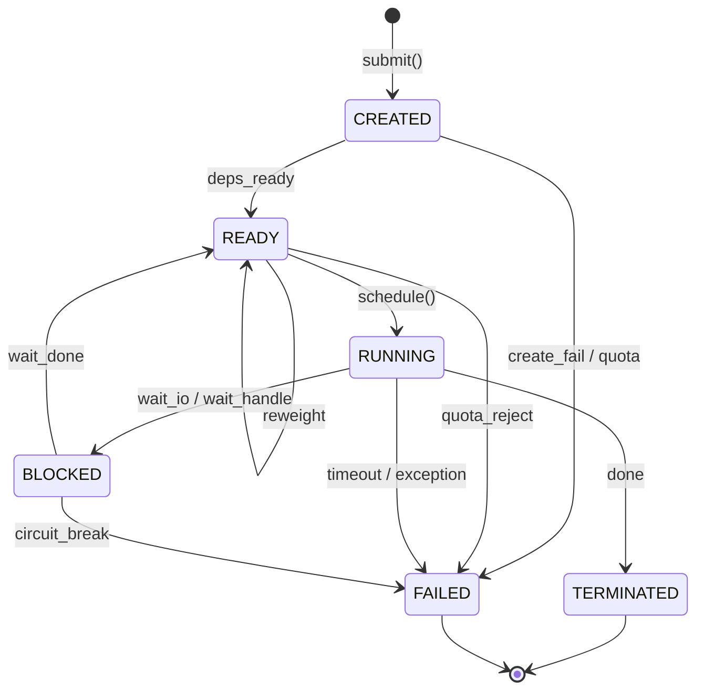

# 六态状态机与合法转换矩阵（T1 交付 · S1）

> 交付人：董博文（T1）　日期：2026-11-17　落盘建议：`docs/design/六态状态机与合法转换矩阵.md`
> 对应本周规划：11/17 交付项「定稿六态状态机与合法转换矩阵，画状态转换图」；验收「6 种状态齐全、非法转换被拒绝并有日志」。

## 一、六态定义

| 状态 | 含义 | 进入条件 | OS 类比 |
| --- | --- | --- | --- |
| `CREATED` | 已登记，依赖未满足，未入队 | `submit()` / 创建成功 | 进程被创建，尚未就绪 |
| `READY` | 依赖满足，在就绪队列等待派发 | 依赖全部 done / 阻塞解除 | 就绪态 |
| `RUNNING` | 已被派发，占用 worker 跑 stub | `next()` 选中并派发 | 运行态 |
| `BLOCKED` | 等 IO / 句柄 / 子任务，可回到 READY | 等待资源 / 等待子任务 | 阻塞 / 睡眠态 |
| `TERMINATED` | 正常完成，终态 | 任务正常结束 | 退出态（僵尸前的终止） |
| `FAILED` | 异常终态，触发故障域处理 | 超时 / 异常 / 配额拒绝 / 熔断 | 异常终止 |

**为什么把 BLOCKED 和 FAILED 分开**：阻塞可回到就绪（等工具返回），失败是终态（要触发故障域处理）。混在一起就没法写「故障不跨执行域」这条不变量，也没法准确统计「受影响任务数」这个指标。

## 二、合法转换矩阵（6×6，实现须逐格覆盖单测）

行 = 从，列 = 到。`✓` 允许，`✗` 禁止（禁止时返回 `E_ILLEGAL_TRANSITION` 并记一条拒绝日志）。

| 从 ＼ 到 | READY | RUNNING | BLOCKED | TERMINATED | FAILED |
| --- | --- | --- | --- | --- | --- |
| **CREATED** | ✓ 依赖满足 | ✗ | ✗ | ✗ | ✓ 创建失败 / 配额拒绝 |
| **READY** | ✓ 重排 | ✓ 被调度 | ✗ | ✗ | ✓ 配额拒绝 |
| **RUNNING** | ✗ | ✗ | ✓ 等 IO / 句柄 | ✓ 正常完成 | ✓ 超时 / 异常 |
| **BLOCKED** | ✓ 等待结束 | ✗ | ✗ | ✗ | ✓ 熔断 |
| **TERMINATED** | ✗ | ✗ | ✗ | ✗（终态自环也禁止） | ✗ |
| **FAILED** | ✗ | ✗ | ✗ | ✗ | ✗（终态自环也禁止） |

矩阵共 30 格（6×6 去掉 CREATED 自身等固定禁止项，实际允许转换 11 条）。**两个终态行、终态列全部为 ✗**，这是「终态不可回退」不变量的直接体现。

允许转换逐条列出（11 条，单测逐条覆盖）：
1. CREATED → READY（依赖满足）
2. CREATED → FAILED（创建失败 / 配额拒绝）
3. READY → READY（重排）
4. READY → RUNNING（被调度）
5. READY → FAILED（配额拒绝）
6. RUNNING → BLOCKED（等 IO / 句柄）
7. RUNNING → TERMINATED（正常完成）
8. RUNNING → FAILED（超时 / 异常）
9. BLOCKED → READY（等待结束）
10. BLOCKED → FAILED（熔断）
11. （自环 READY → READY 计为重排，允许；其余终态自环禁止）

## 三、状态转换图（Mermaid，可贴进文档与 README）

图与矩阵语义必须一致：图里出现的每条边都能在矩阵里找到对应的 ✓；图里没有的箭头，实现里必须拒绝。

## 四、状态不变量与验证方式（详见《设计草稿三件事》第一件）

- **I1 状态唯一**：任一时刻一个 Agent 只有一个 `state` 值 → 由 `transition()` 单一入口保证 → 单测：并发发起两次转换，断言只生效一次。
- **I2 终态不可回退**：TERMINATED / FAILED 无出边 → 由矩阵终态行全 ✗ 保证 → 单测：对终态发起任意转换，断言抛 `E_ILLEGAL_TRANSITION`。
- **I3 阻塞只回就绪**：BLOCKED 出边只有 READY 和 FAILED → 由矩阵保证 → 单测：BLOCKED → RUNNING 被拒绝。
- **I4 终态回收**：进入 TERMINATED / FAILED 时句柄全部回收 → 由 `transition()` 内调用 `release_all()` 保证 → 单测：终态后断言句柄表该 owner 记录为 0。

## 五、验收对照（本周规划第三节 11/17 行）

| 验收项 | 本交付是否满足 | 证据 |
| --- | --- | --- |
| 6 种状态齐全 | ✓ | 第一节六态定义 + 枚举定义 |
| 非法转换被拒绝并有日志 | ✓ | 第二节矩阵 + 第四节不变量 I2/I3 + 契约① `transition()` 签名 |

> 实现的单测与日志由陈苗苗（T2）按契约①落地，命令：`python -m pytest -q tests/test_agent.py -k illegal_transition`，截图要能看到非法转换被拒绝。
